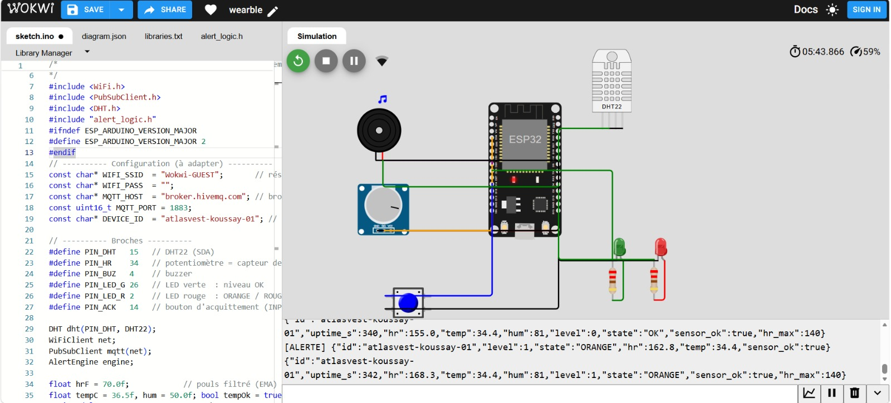
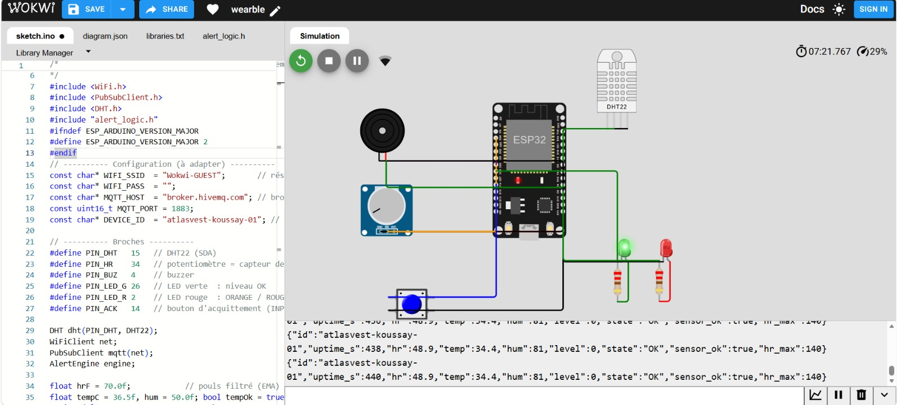

# AtlasVest — Smart Vest : simulation Wokwi (ESP32 + MQTT)

Mini-projet **Wearable Technology** — ESPRIM, 5ᵉ année Génie Électronique Embarqué & Télécoms, 2026/2027 S1 (enseignant : A. Kammoun).
Auteur : Koussay.

Ce dépôt regroupe le **code, les données et le rapport** du projet (2ᵉ partie : simulation, dépôt GitHub).
Le rapport de conception (SDD, 11 pages) est dans [`report/`](report/AtlasVest_SDD_Wearable_Technology.pdf).

## Ce que simule le projet

Un gilet connecté d'ultra-trail simplifié, **sans aucun matériel**, dans le simulateur [Wokwi](https://wokwi.com) :

| Composant simulé | Rôle | Broche ESP32 |
|---|---|---|
| DHT22 | température / humidité (peau ou ambiance) | GPIO15 |
| Potentiomètre | capteur de pouls : 0 → 4095 ⇒ 40 → 200 bpm | GPIO34 (ADC1) |
| Buzzer | alerte sonore (intermittent = ORANGE, continu = ROUGE) | GPIO4 |
| LED verte / rouge | niveau OK / alerte | GPIO26 / GPIO2 |
| Bouton | acquittement du buzzer ORANGE pendant 30 s | GPIO14 (pull-up) |
| Wi-Fi + MQTT | envoi JSON vers le cloud (broker public HiveMQ) | — |

Câblage de départ : exemple Wokwi de Prof. Arnott Ramos Caiado (COMPET Senac PE), adapté (DHT22, potentiomètre, bouton, broches). 
Le DHT22 est réglé à 36,8 °C par défaut (température corporelle) : à 21 °C, le gilet signalerait « capteur décroché » (T < 34 °C).

Règles du sujet : **buzzer si le pouls dépasse 140 bpm ou si la température est anormale**.

| Niveau | Condition |
|---|---|
| **ORANGE** | pouls > 140 bpm, ou T ≥ 38,0 °C, ou T < 34,0 °C (capteur décroché), ou DHT22 en défaut |
| **ROUGE** | pouls ≥ 180 bpm, ou T ≥ 39,5 °C (buzzer continu, non acquittable) |

Un changement de niveau demande **3 mesures consécutives** (1 Hz) et le retour utilise une **hystérésis** (5 bpm, 0,3 °C).
Le pouls est lissé par un filtre EMA (mini traitement « Edge »). Le seuil de 140 bpm est configurable à distance
(`hr_max=150`) car un trailer dépasse couramment 140 bpm : il doit être calibré sur l'athlète.

## Lancer la simulation (≈ 5 min)

1. Ouvrir le projet Wokwi : <https://wokwi.com/projects/480057647083813889>
   (ou créer un projet ESP32 sur <https://wokwi.com> et y copier les fichiers de `sim/wokwi/`).
2. Si besoin, remplacer/ajouter les fichiers de [`sim/wokwi/`](sim/wokwi) : `sketch.ino`, `alert_logic.h` (nouveau fichier), `diagram.json`, `libraries.txt`.
3. Dans `sketch.ino`, rendre `DEVICE_ID` unique (le broker est public et partagé).
4. Cliquer **Start** : le moniteur série affiche le JSON publié toutes les 2 s.

**Scénarios à essayer**

| Action dans Wokwi | Résultat attendu |
|---|---|
| Potentiomètre vers 50 % (≈ 120 bpm) | LED verte, pas de buzzer |
| Potentiomètre > 63 % (> 140 bpm) | ORANGE après quelques secondes (filtre + confirmation), buzzer intermittent |
| Potentiomètre > 88 % (> 180 bpm) | ROUGE, buzzer continu |
| Cliquer le DHT22 → température 38,5 °C | ORANGE |
| Température 40 °C | ROUGE |
| Appuyer sur le bouton en ORANGE | buzzer coupé 30 s (ROUGE non acquittable) |

**À quoi sert le bouton ?** C'est l'*acquittement* : en niveau ORANGE, il coupe le buzzer 30 s (l'athlète signale « j'ai vu l'alerte »)
sans effacer l'alerte (la LED reste active et les données continuent d'être envoyées). En ROUGE il est **sans effet** (sécurité).
Son action n'est visible que pendant une alerte ORANGE ; le moniteur série affiche `[ACK] ...` à chaque appui.

**Dépannage LED** : au démarrage, un autotest allume la LED verte, la rouge, puis le buzzer ; le moniteur affiche `[TEST] ...` et les broches utilisées.
Si une LED ne s'allume pas pendant l'autotest, le problème est le câblage (broche, résistance, cathode vers GND), pas la logique.
La LED intégrée de la carte est aussi sur GPIO2 : elle suit la LED rouge.

**Voir les données dans le cloud**

```bash
pip install -r requirements.txt
python tools/mqtt_logger.py --id atlasvest-koussay-01              # enregistre data/telemetry_live.csv
python tools/mqtt_logger.py --id atlasvest-koussay-01 --cmd "hr_max=150"   # change le seuil à distance
```

Topics : `esprim/wearable/<DEVICE_ID>/telemetry` (2 s), `/alert` (changement de niveau, message retenu),
`/status` (online/offline, testament MQTT), `/cmd` (commandes).

## Tests de la logique d'alerte (sur PC)

La logique est isolée dans [`sim/wokwi/alert_logic.h`](sim/wokwi/alert_logic.h) (aucune dépendance Arduino) :
le **même fichier** est utilisé par l'ESP32 et par le test.

```bash
make test        # g++ -std=c++17 ... && ./tests/test_alert
```

Résultat : **16/16 scénarios réussis** ([`tests/resultat_tests.txt`](tests/resultat_tests.txt)) — repos, pic isolé, confirmation,
escalade ORANGE → ROUGE, hystérésis, températures haute/basse, capteur en défaut, seuil personnalisé.
La trace de l'exécution est dans [`data/scenario_trace.csv`](data/scenario_trace.csv).

## Captures de la simulation

| Niveau ORANGE (pouls > 140 bpm, buzzer actif) | Niveau OK (LED verte) |
|---|---|
|  |  |

## Structure du dépôt

```
sim/wokwi/   sketch.ino, alert_logic.h, diagram.json, libraries.txt, wokwi-project.txt
tests/       test_alert_logic.cpp, resultat_tests.txt
tools/       mqtt_logger.py (MQTT -> CSV)
analysis/    simulation_debruitage_ECG.py, calculs_antenne_et_puissance.py, resultats_simulation.json
data/        scenario_trace.csv (+ telemetry_live.csv généré, ignoré par git)
docs/        captures d'écran de la simulation Wokwi
report/      AtlasVest_SDD_Wearable_Technology.pdf
```

`analysis/` contient la simulation ECG (NLMS vs autoencodeur INT8, Axe 2) et les calculs d'antenne / de bilan de puissance du rapport.

## Lien avec la conception AtlasVest

| Conception (rapport) | Simulation |
|---|---|
| ECG → fréquence cardiaque | Potentiomètre + filtre EMA (pas d'ECG réel) |
| NTC peau + SHT45 | DHT22 |
| nRF5340 (BLE) + nRF9161 (NB-IoT) | ESP32 Wi-Fi + MQTT (cible imposée par le sujet) |
| États OK / ORANGE / ROUGE, mode dégradé | Identiques (machine à 3 niveaux, DHT22 en défaut → ORANGE) |

## Limites

- Wokwi ne modélise ni l'ECG, ni l'AFE, ni l'antenne textile, ni la batterie : ces points sont traités par calcul dans le rapport.
- Le broker HiveMQ public n'a **ni TLS ni authentification** : ne jamais y envoyer de vraies données de santé.
  En conditions réelles : MQTT sur TLS (8883) avec authentification.
- Produit « bien-être » : ce n'est pas un dispositif médical.
